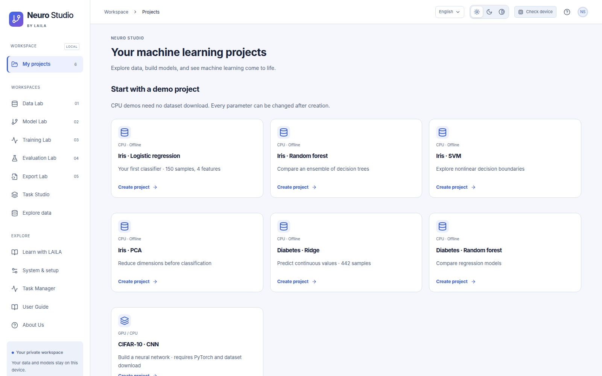
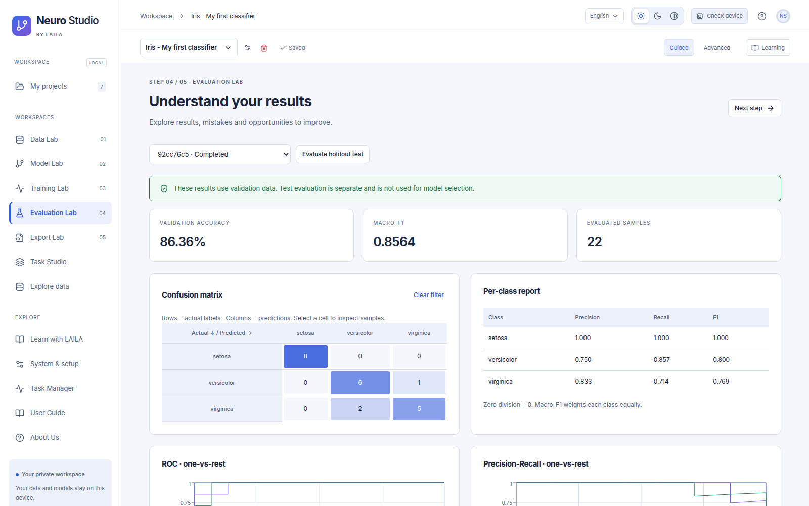
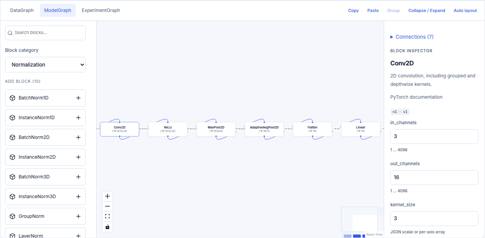
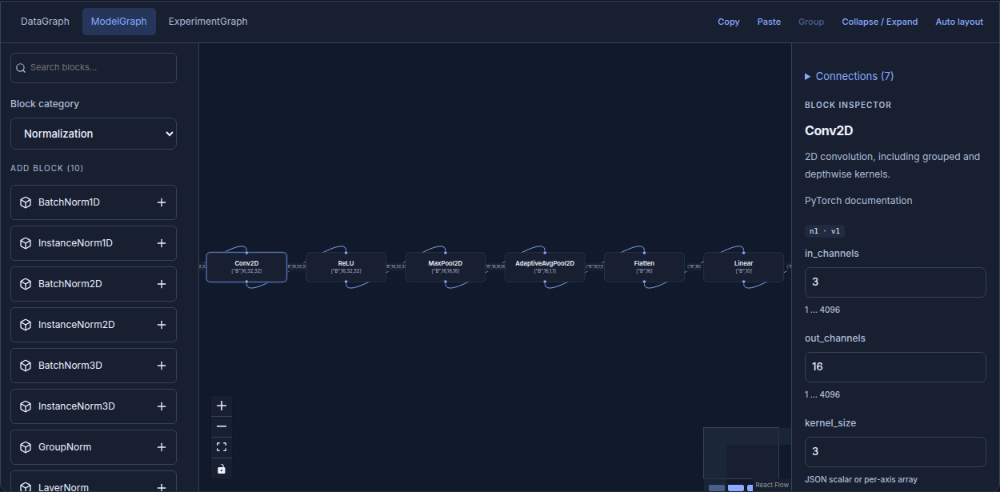
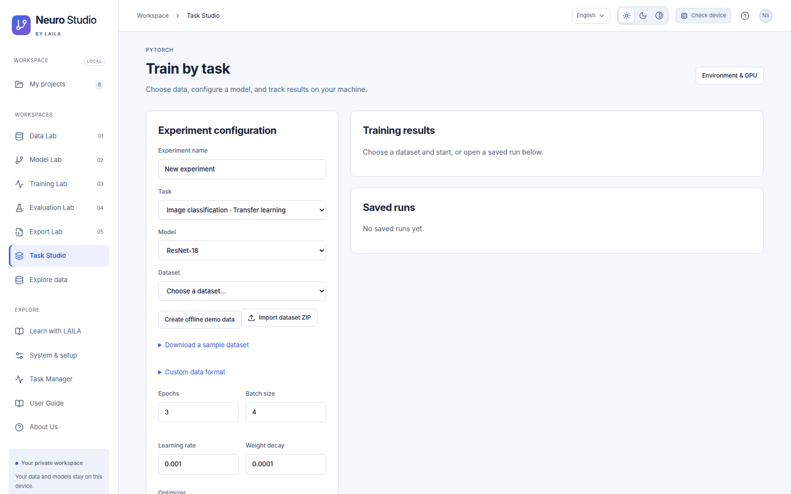
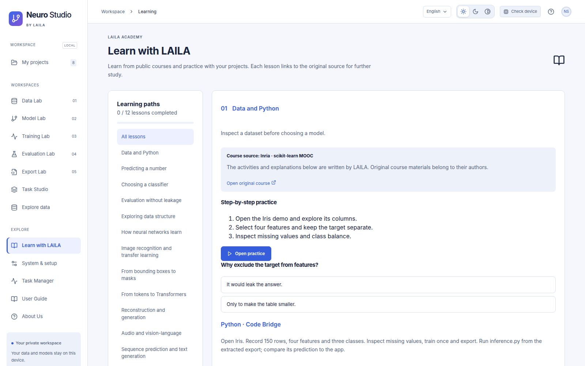

<p align="center">
  
</p>
<h1 align="center">Neuro Studio</h1>
<p align="center">Build, train and understand machine learning models in your browser.</p>
<p align="center">
  <a href="https://github.com/BongoJuniorrr/NeuroStudio/releases/tag/v0.0.1-beta">Beta v0.0.1</a> ·
  <a href="LICENSE">MIT license</a> ·
  <a href="#your-first-model">User guide</a> ·
  <a href="https://github.com/BongoJuniorrr/NeuroStudio/issues">Report an issue</a>
</p>

Neuro Studio is a **single-user, local visual machine learning workspace** by **LAILA Technical Team**. Its website helps you import data, assemble models, tune training, inspect results and export independent Python projects. Computation runs in real Python, scikit-learn and PyTorch. PyTorch prefers a working GPU and falls back to CPU when the initial GPU probe cannot run.


*Start from a demo or import your own data. Screenshots show real application workflows.*

## Download beta v0.0.1

| Platform | Download | Start after extracting |
|---|---|---|
| Windows x86-64 | [Windows ZIP](https://github.com/BongoJuniorrr/NeuroStudio/releases/download/v0.0.1-beta/NeuroStudio-0.0.1-beta-windows-x64.zip) | Double-click **Start Neuro Studio.cmd** |
| Linux x86-64 | [Linux ZIP](https://github.com/BongoJuniorrr/NeuroStudio/releases/download/v0.0.1-beta/NeuroStudio-0.0.1-beta-linux-x64.zip) | Run **`bash start.sh`** |

[Release notes and checksums](https://github.com/BongoJuniorrr/NeuroStudio/releases/tag/v0.0.1-beta). Download the platform ZIP asset for the bundled uv executable and built website. The GitHub-generated source archives also include the built website; their launchers download uv when it is unavailable.

**No Node.js, Docker or GitHub account is required to use the packaged application.** The launcher prepares Python 3.12 and a small application environment, then opens a local browser page. First setup needs internet and disk space for dependencies. An NVIDIA GPU is optional; compatible drivers are needed for CUDA. Model weights and datasets download separately.

This beta has been exercised on Linux CPU and Tesla P100 GPUs. Windows and Linux ZIPs include platform launchers. The in-app User Guide covers setup and troubleshooting. Additional GPUs, accessibility review and non-technical user pilots remain validation work. This is an early beta, not a guarantee of full proposal coverage or compatibility with every model/driver.

## Your first model

1. Start Neuro Studio and open **System & setup**. Choose the lightweight ML environment for Iris/CSV, or automatic PyTorch setup for neural models.
2. Choose **Iris - Logistic regression** from the project templates.
3. Open **Data Lab** to inspect the dataset and train/validation/test split.
4. Adjust model parameters in **Model Lab**, then choose metrics and start in **Training Lab**.
5. Inspect validation results in **Evaluation Lab**. Evaluate the reserved test set after selecting your model.
6. Open **Export Lab** to download an independent Python model project.

English is the default; Vietnamese is available. Appearance has light, dark and high contrast icon controls. The in-app **User Guide** explains the full workflow, setup, updates and troubleshooting.


*Validation metrics, per-class results and prediction inspection use the trained model.*

## Visual model builder

Build tensor graphs using **100 supported tensor operators plus Input/Output**, with searchable categories, direct parameter editing, shape propagation, parameter counts and generated Python. Available families include convolution/transposed convolution in 1D/2D/3D, normalization, pooling, activations, padding/resizing, tensor reshaping, residual merges and sequence layers.

BatchNorm2D exposes `num_features`, `eps`, `momentum`, `affine` and `track_running_stats`. Convolution supports grouped/depthwise configurations, padding modes and per-axis geometry. Spatial parameters accept JSON scalars/arrays; nullable settings accept `null`. Full names wrap in palette buttons while both icons retain their size.


*ModelGraph runs through the same configuration used by training and standalone export.*


*Light, dark and high contrast are available across the application.*

Connections currently carry one tensor; external recurrent states, pooling-index ports and attention mask/weight ports are not exposed. The graph dataset adapter accepts RGB images; Task Studio handles separate pretrained text/audio/time-series workflows.

## Features

| Area | Available in beta |
|---|---|
| Projects | Templates, rename/clone, autosave/revisions, undo/redo, searchable switcher, trash/restore |
| Data | Iris/Diabetes/CIFAR-10, CSV and image imports, profiling, train-only preprocessing, duplicate checks, flexible separate train/validation/test uploads |
| Classical ML | Eight classifiers and eight regressors, PCA, train-only cross-validation and bounded hyperparameter search |
| Neural training | Real PyTorch workers, GPU probe/CPU fallback, optimizer/scheduler settings, early stopping, best checkpoints, CNN epoch resume, cancel/timeout |
| Metrics and loss | Multiple monitored metrics, mandatory primary objective, F1/precision/recall/AUC, regression/mask/detection/generation metrics, task-compatible losses and custom formulas/Python |
| Task Studio | Image/text/audio classification, semantic segmentation, detection, autoencoder/VAE, causal/seq2seq text generation and scalar time-series forecasting |
| Transfer learning | 15 torchvision backbones; BERT/DistilBERT/DeBERTa/GPT2 families, selected LoRA workflow, compatible custom local weights/Hugging Face models |
| Exploration | KMeans/DBSCAN/agglomerative clustering, PCA/t-SNE/UMAP, fitted exploration export |
| Monitoring | Task Manager with job cancellation and whole-machine CPU/RAM/NVIDIA GPU usage |
| Learning | 12 attributed bilingual public-course pathways, original practice activities, code examples and quizzes |
| Portability | Standalone Python export, workspace backup/restore, engine rollback, same-platform offline dependency bundles for selected profiles |


*Choose a task and compatible model, then configure data, objectives and the memory budget.*


*Original course links and attribution are displayed beside each LAILA exercise.*

The in-app User Guide describes data formats, training settings and exports. Learn with LAILA links each lesson to its original public course.

## Hardware and storage

- **Operating systems:** Windows/Linux x86-64. The managed runtime uses Python 3.12.
- **Starting small:** Iris and tabular demos use CPU; a GPU is not required. Larger models need more RAM, VRAM and disk space.
- **NVIDIA:** automatic setup selects a compatible CUDA profile. Older GPUs such as P100 use the legacy CUDA profile; detecting a GPU with nvidia-smi does not make CPU-only PyTorch use CUDA.
- **Memory:** start with small batches and sample limits. The allocator budget reduces pressure but does not cover CUDA context/libraries or memory used by other applications.
- **Default workspace:** Linux `~/.local/share/NeuroStudio`; Windows `%LOCALAPPDATA%\NeuroStudio`. Data stays outside the source folder.
- **Internet/offline:** first installation and uncached datasets/weights need internet. System & setup can build an offline bundle for the current operating system and selected tabular/analysis/CPU profile. Dataset/model caches are excluded.

To select a workspace and keep the browser closed on a server:

```bash
bash start.sh --no-browser --port 8765 --data-dir /path/to/workspace
```

The application binds to localhost. Closing a browser tab leaves training running; stopping the launcher shuts down its workers. Use it as a local, single-user application. Custom metric/loss Python runs with your own user permissions.

## Updating and recovery

Create a workspace backup, stop the launcher, extract the new release into a separate directory and launch with the same `--data-dir`. Keep the old source directory for rollback. Engine rollback is separately available in System & setup. Refresh the browser with Ctrl+Shift+R after an update. Do not delete the workspace to update the source.

There is no automatic source updater. Backup restore creates a new workspace directory rather than overwriting an active one. See the in-app User Guide for recovery instructions.

## Development

End users can skip this section. Development needs Python 3.12, uv and Node.js 22.

```bash
git clone https://github.com/BongoJuniorrr/NeuroStudio.git
cd NeuroStudio
uv sync --extra engine --extra analysis --extra dev --locked
uv pip install -r src/neurostudio/torch-cpu.lock --require-hashes
npm ci --prefix apps/web
npm run build --prefix apps/web
uv run --no-sync neurostudio --no-browser
```

## Known limits

This is an early beta. Connections carry a single tensor; external recurrent state, pooling indices and attention masks are not exposed. CLIP/GAN and advanced video/diffusion workflows are not included. Model and driver compatibility varies. Start with the demo projects and small batch sizes.

## Team, license and contact

Developed by **LAILA Technical Team**. LAILA brings students together to learn and apply AI through shared learning, practical projects and community activities.

- [LAILA website](http://laila.thvphuong.id.vn/)
- [LAILA Facebook](https://www.facebook.com/profile.php?id=61580590178314)
- [Issues and feedback](https://github.com/BongoJuniorrr/NeuroStudio/issues)

Source code: **MIT**. See [LICENSE](LICENSE) and [third-party notices](THIRD_PARTY_NOTICES.md). Datasets, pretrained weights and original course materials retain their own terms. Branding does not imply endorsement of modified versions.
